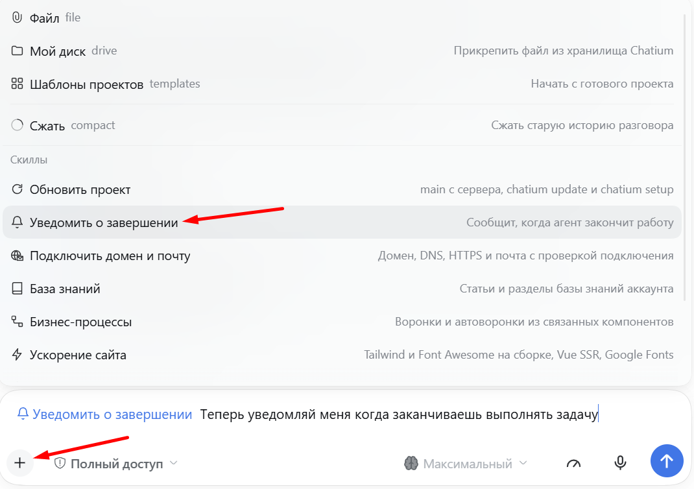
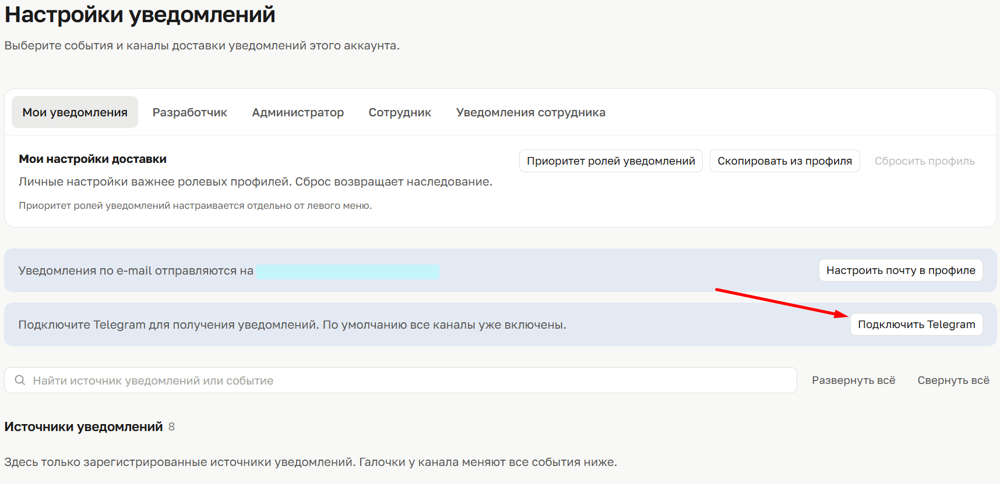

# Уведомить о завершении — навык для Chatium Code

Когда агент заканчивает задачу, он присылает уведомление в центр уведомлений Chatium, на e-mail
или в Telegram. Не нужно ждать у экрана и проверять вкладку — приходит само.

Навык для [Chatium Code](https://chatium.ru): ставится в аккаунт или в окружение, работает
со штатными уведомлениями платформы, без внешних сервисов и токенов.

## Что делает

- В конце задачи, которая длилась дольше порога, отправляет одно уведомление: «Готово: …» и
  короткий текст, что сделано.
- Если агенту нужен ответ, присылает отдельное «Нужен ответ: …» — до того, как остановится
  и будет ждать.
- Каналы каждый выбирает сам: центр уведомлений, почта, Telegram — в «Настройках доставки».
- Порог настраивается: 3 минуты, 10, 30 или «всегда».

## Установка

Вставьте ссылку на этот репозиторий в сессию Chatium Code и попросите:

> Поставь навык из https://github.com/dvoretskybusiness/agent-finish-notify

Агент прочитает навык, покажет, что он делает, и спросит, куда поставить: **для всего аккаунта**
(навык получат все сотрудники) или **только в это окружение**. Ставится один раз.

> **Важно: установка не включает уведомления.** Они подключаются в каждой сессии отдельно —
> «+» в поле ввода → «Уведомить о завершении». Если этого не сделать, агент не узнает, что нужно
> уведомлять, и ничего не придёт.

Обновление — той же фразой: агент переустановит навык и покажет, что изменилось. Раз в сутки навык
сам проверяет релизы на GitHub и предлагает обновиться, если вышла новая версия; отказ запоминается.
История изменений — в [CHANGELOG.md](CHANGELOG.md).

## Агенту, который устанавливает навык

После установки обязательно: покажите снимок `agent-finish-notify/assets/skill-plus-menu.png`,
объясните, что уведомления включаются **в каждой сессии отдельно** через «+», и скажите, что каналы
и порог спросятся при первом использовании. Чек-лист продублирован в начале `SKILL.md`.

## Включение в сессии

Установка сама по себе уведомления не включает: в каждой сессии, где они нужны, навык вызывают
отдельно.

1. Нажмите **«+»** в поле ввода.
2. Выберите **«Уведомить о завершении»**.
3. При желании допишите, что нужно, например: «Теперь уведомляй меня, когда заканчиваешь
   выполнять задачу».



В новой сессии — снова «+». Так уведомления не приходят из чужих диалогов.

## Категория уведомлений

Чтобы можно было выбирать каналы, в аккаунте должна быть объявлена категория
«Агент Chatium code: уведомление». Навык проверяет её при первом запуске и, если её нет, предлагает
добавить: один файл и одна строка импорта в коде аккаунта, разово и с вашего согласия.

Без категории навык тоже работает, но включены сразу все каналы — центр, почта и Telegram.

Где посмотреть: левое меню → **значок конверта** «Уведомления» → «Настройки доставки» →
категория «Агент Chatium code: уведомление». Ползунки под конвертом — это настройка левого меню,
к уведомлениям они не относятся.

## Подключение Telegram и почты

Если Telegram не подключён — левое меню → «Уведомления» (значок конверта) → шестерёнка
«Настройки уведомлений» → кнопка «Подключить Telegram», дальше по инструкции на экране.



Почта подключается там же: «Настроить почту в профиле». Письма пойдут только после подтверждения
адреса. Если оба канала уже работают, ничего настраивать не нужно.

Подробная инструкция Chatium: [Уведомления: куда приходят и как настроить](https://chatium.ru/app/knowledge/~/baza-znaniy/vash-akkaunt/uvedomleniya-kuda-prihodyat-i-kak-nastroit.md).

## Долгие диалоги

Настройки и отметка сессии хранятся в окружении, а не только в контексте диалога, поэтому
переживают `/compact`. Если агент всё же перестал уведомлять, скажите одной фразой:

> Продолжай уведомлять о завершении задач

Навык включится снова, настройки переспрашивать не будет.

## Что нужно

- Аккаунт Chatium и доступ к Chatium Code.
- Для почты — подтверждённый адрес в профиле, для Telegram — подключённый бот уведомлений.
- Право публиковать код аккаунта — только если захотите добавить категорию. Без него навык
  работает в режиме «все каналы».

## Приватность

Навык отправляет уведомления только через SDK Chatium и только самому пользователю
(`ctx.user.id`). Никаких внешних запросов, вебхуков, токенов и передачи данных третьим лицам.
Текст уведомления — это итог задачи, без секретов и лишних персональных данных.

## Устройство

```
agent-finish-notify/
├── SKILL.md                  инструкция агенту
├── agents/openai.yaml        название и иконка в меню
├── assets/                   снимки интерфейса и иконка
├── references/
│   ├── setup.md              первичная настройка и смена каналов
│   └── declaration.md        как добавить категорию в аккаунт
└── scripts/state.mjs         состояние: настройки и отметки сессий
```

## Автор и лицензия

Автор: Владимир Дворецкий.

Лицензия MIT — можно использовать, менять и распространять, сохранив текст лицензии.
