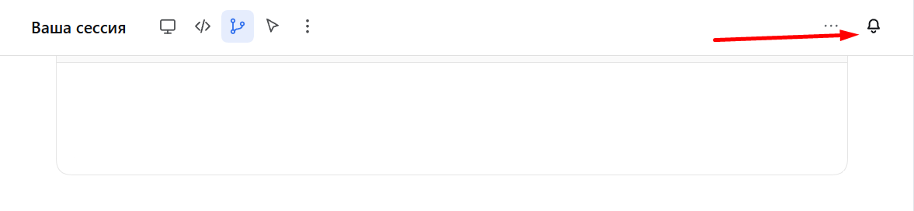

# Уведомления агента: установка и настройка

Уведомления отправляет плагин: он сам следит за сессиями и не зависит от того, помнит ли агент
что-то вызвать. Навык нужен, чтобы поставить плагин, объявить категорию и настроить каналы.

## Что делает плагин

- **колокольчик в шапке сессии** и панель настроек: порог, звук, громкость, каналы;
- **«Задача выполнена»** — когда ход закончился и длился дольше порога;
- **«Нужен ответ»** — когда агент ждёт подтверждения прав;
- **«Прервано»** — если процесс Chatium Code остановился до конца хода;
- **доставка**: браузер (пока вкладка открыта), центр уведомлений, Telegram, почта;
- **не мешает**: если вы смотрите на эту сессию — молчит; ушли из вкладки — браузерное
  уведомление и «●» в заголовке; закрыли вкладку — Telegram.

## Где панель

Колокольчик — в шапке сессии, крайний справа, после меню «…». Нажмите — откроется панель с
порогом, звуком и каналами. Вызывать навык для этого не нужно и включать его в каждой сессии
тоже не нужно.



## Установка

Спроси согласие и объясни честно:

- добавятся файлы в `$DSH_HOME/plugins` и одна строка в профиль `web`;
- сразу после обновления вкладки работают панель и браузерные уведомления;
- доставка при закрытой вкладке включается при **следующем штатном** запуске Chatium Code;
- процесс перезапускать нельзя: это оборвёт текущую сессию.

Установка:

```bash
bash .agents/skills/agent-finish-notify/scripts/install-plugin.sh
```

Затем попроси обновить вкладку (Ctrl+R). Скрипт идемпотентен: повторный запуск ничего не дублирует.

## Категория уведомлений

Без объявленной категории нельзя выбрать каналы: уведомление уйдёт сразу во все. Проверь наличие
и при отсутствии добавь по [references/declaration.md](references/declaration.md). Категория
называется «Агент Chatium code: уведомление».

## Каналы

- **Браузер** — переключатель в панели; нужен разрешение браузера.
- **Центр, Telegram, почта** — каналы категории в «Настройках доставки» Chatium; в панели они же
  показываются переключателями.
- Telegram подключается так: левое меню → **значок конверта** «Уведомления» → **шестерёнка**
  «Настройки уведомлений» → «Подключить Telegram» (`@chatium_notifications_bot`).
- Почта: там же «Настроить почту в профиле», письма идут после подтверждения адреса.

Снимки и пошаговые инструкции — [references/setup.md](references/setup.md).

Полная инструкция Chatium (публичная):
https://chatium.ru/app/knowledge/~/baza-znaniy/vash-akkaunt/uvedomleniya-kuda-prihodyat-i-kak-nastroit.md

## Проверка

1. Панель: колокольчик → «Проверить» — приходит браузерное уведомление и звук.
2. Задача дольше порога, уход из вкладки — уведомление и «●» в заголовке.
3. Закрытая вкладка — сообщение в Telegram.

## Если не работает

- **Панели нет** — плагин не установлен или вкладка не обновлена.
- **Нет браузерных уведомлений** — не выдано разрешение браузера (кнопка в панели).
- **Нет в Telegram** — канал не подключён или выключен в настройках доставки.
- **Нет доставки при закрытой вкладке** — серверная часть ещё не загрузилась: нужен штатный
  старт Code, принудительно перезапускать не надо.
- **Аккаунт без доступа к `$DSH_HOME`** — ручной режим: [references/fallback.md](references/fallback.md).
